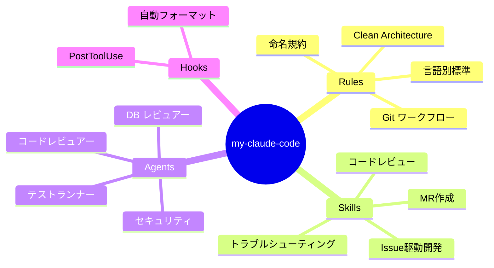
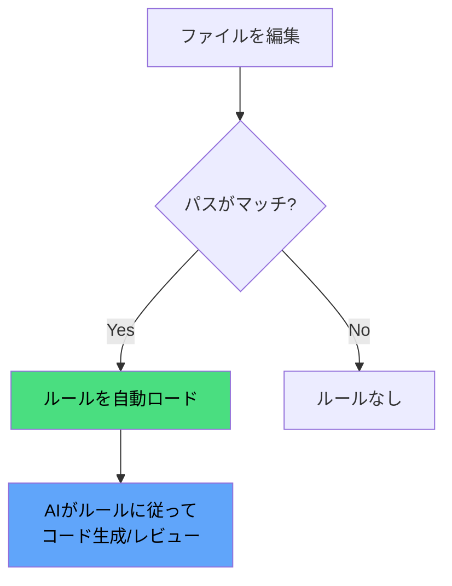
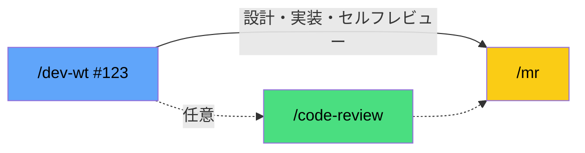
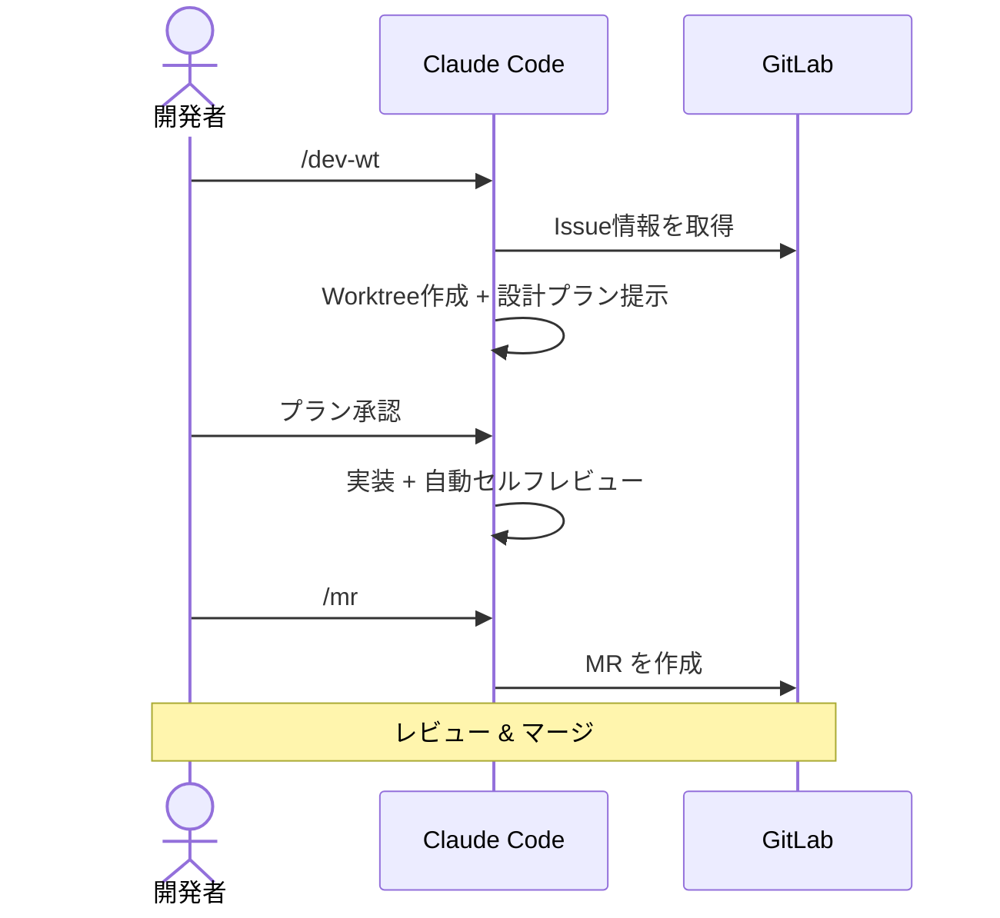
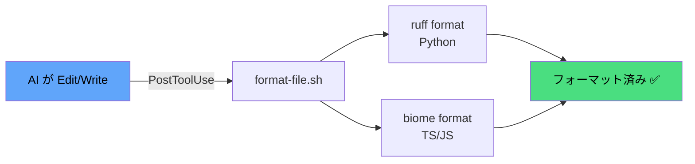
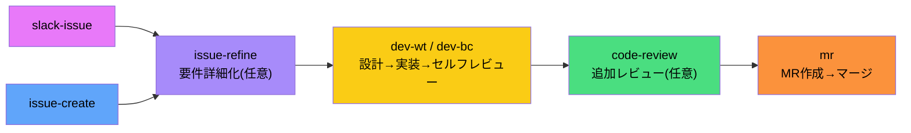

# Claude活用ガイド

### AI駆動の開発ワークフロー

<div class="pt-12">
  <span class="px-2 py-1 rounded cursor-pointer" hover="bg-white bg-opacity-10">
    my-claude-code で始める実践ガイド
  </span>
</div>

<div class="abs-br m-6 flex gap-2 text-sm opacity-50">
  <span>my-claude-code</span>
  <span>|</span>
  <span>2026</span>
</div>

<!--
このスライドは my-claude-code の使い方を説明するプレゼンテーションです。
初心者にもわかりやすく、実際の開発フローに沿って解説します。
-->

---
transition: fade-out
layout: center
---

# 今日のゴール

<div class="grid grid-cols-3 gap-8 pt-8 text-center">

<div v-click class="p-6 rounded-lg bg-blue-500 bg-opacity-10 border border-blue-500 border-opacity-30">
  <div class="text-4xl mb-4">🤖</div>
  <div class="font-bold text-lg">理解する</div>
  <div class="text-sm opacity-70 mt-2">my-claude-code<br/>の全体像</div>
</div>

<div v-click class="p-6 rounded-lg bg-green-500 bg-opacity-10 border border-green-500 border-opacity-30">
  <div class="text-4xl mb-4">⚡</div>
  <div class="font-bold text-lg">使えるようになる</div>
  <div class="text-sm opacity-70 mt-2">インストールから<br/>日常の開発フローまで</div>
</div>

<div v-click class="p-6 rounded-lg bg-purple-500 bg-opacity-10 border border-purple-500 border-opacity-30">
  <div class="text-4xl mb-4">🔧</div>
  <div class="font-bold text-lg">カスタマイズできる</div>
  <div class="text-sm opacity-70 mt-2">自分のプロジェクトに<br/>合わせた設定</div>
</div>

</div>

---
layout: two-cols
layoutClass: gap-8
---

# アジェンダ

<Toc text-sm minDepth="1" maxDepth="1" />

::right::

<div class="h-full flex items-center justify-center">
<div class="text-8xl opacity-20">📋</div>
</div>

---
transition: slide-up
---

# my-claude-code とは？

AI コーディングツールの**共有設定プラグイン**（マーケットプレイス配布）

<div class="grid grid-cols-2 gap-6 mt-8">

<div v-click>

### 課題

- プロジェクトごとにAI設定をゼロから作成
- チーム内でAIの品質にばらつき
- ベストプラクティスが属人化
- 複数AIツールの設定が散逸

</div>

<div v-click>

### 解決

- **本番検証済み**の設定プラグイン
- チーム全員が同じ品質基準でAIを活用
- ルール・スキル・エージェントを一元管理
- **4つのAIツール**を同時サポート

</div>

</div>

<div v-click class="mt-8 p-4 rounded bg-blue-500 bg-opacity-10 border-l-4 border-blue-400">
💡 つまり「AIコーディングの標準キット」です
</div>

---

# プラグインの構成要素

<div class="mt-4"></div>



---
layout: center
class: text-center
---

# 3つの核心コンセプト

<div class="grid grid-cols-3 gap-12 mt-12">

<div v-click class="text-center">
  <div class="text-6xl mb-4">📏</div>
  <div class="text-2xl font-bold text-blue-400">Rules</div>
  <div class="text-sm opacity-70 mt-3">AIが従うべき<br/><strong>開発ルール</strong></div>
</div>

<div v-click class="text-center">
  <div class="text-6xl mb-4">🎯</div>
  <div class="text-2xl font-bold text-green-400">Skills</div>
  <div class="text-sm opacity-70 mt-3">再利用可能な<br/><strong>ワークフロー</strong></div>
</div>

<div v-click class="text-center">
  <div class="text-6xl mb-4">🤖</div>
  <div class="text-2xl font-bold text-purple-400">Agents</div>
  <div class="text-sm opacity-70 mt-3">専門特化の<br/><strong>サブAI</strong></div>
</div>

</div>

---
transition: fade-out
---

# Rules — AIが守るべき開発ルール

ファイルパスに応じて**自動的に適用**される開発ガイドライン

<div class="text-sm mt-2">

| ルール | 対象パス | 内容 |
|--------|----------|------|
| `clean-architecture` | `**/backend/**/*.py` | Domain/App/Adapter層の分離 |
| `naming-conventions` | `**/*.py` | snake_case, `_list`サフィックス等 |
| `database` | `**/migrations/**` | スキーマ・クエリの規約 |
| `git-workflow` | 常時適用 | ブランチ命名・コミット規約 |
| `frontend-standards` | `**/frontend/**/*.tsx` | TypeScript/React規約 |
| `python-standards` | `**/*.py` | Python固有のベストプラクティス |
| `rust-standards` | `**/*.rs` | Rustエラーハンドリング等 |

</div>

<div v-click class="mt-2 p-2 rounded bg-yellow-500 bg-opacity-10 border-l-4 border-yellow-400 text-sm">
⚡ ルールはフロントマターの <code>paths:</code> フィールドで対象ファイルを指定します
</div>

---

# Rules — 仕組み

<div class="grid grid-cols-2 gap-6 mt-4">

<div>

### ルールファイルの構造

```md {all|1-4|6-12|all}
---
paths:
  - "**/*.py"
---

# 命名規約

- ファイル/関数: `snake_case`
- クラス: `PascalCase`
- 定数: `UPPER_SNAKE_CASE`
- 配列: `_list` サフィックス必須
- 真偽値: `is_` プレフィックス必須
```

</div>

<div v-click>

### 自動適用の流れ



<div class="mt-4 text-sm opacity-70">
例: <code>backend/app/service.py</code> を編集<br/>
→ <code>clean-architecture.md</code> + <code>naming-conventions.md</code> + <code>python-standards.md</code> が自動適用
</div>

</div>

</div>

---

# Skills — 再利用可能なワークフロー

スラッシュコマンドで呼び出す**定型作業の自動化**

<div class="grid grid-cols-2 gap-6 mt-6">

<div>

### 開発系スキル
<div class="text-sm">

| コマンド | 概要 |
|----------|------|
| `/code-review` | 未コミット変更のレビュー |
| `/code-review-full` | コードベース全体のレビュー |
| `/mr` | マージリクエスト作成 |
| `/dev-wt` | Worktreeでのissue駆動開発 |
| `/dev-bc` | ブランチでのissue駆動開発 |

</div>
</div>

<div v-click>

### 補助系スキル
<div class="text-sm">

| コマンド | 概要 |
|----------|------|
| `/explain` | コードの解説 |
| `/issue-create` | GitLab Issue作成 |
| `/issue-refine` | 曖昧なIssueの詳細化 |
| `/refactor-clean` | リファクタリング支援 |
| `/troubleshooting` | 問題診断 |
| `/slack-issue` | Slack → Issue連携 |

</div>
</div>

</div>

---

# Skills — 使い方

プロンプトで `/` に続けてスキル名を入力するだけ

```bash
> /code-review                      # 未コミット変更をレビュー
> /dev-wt #123                      # Issue #123 の開発を Worktree で開始
> /mr                               # マージリクエストを作成
> /code-review-est backend/app/     # 特定フォルダの既存コードをレビュー
```

<div v-click class="mt-6">

### スキルの組み合わせ例: Issue → 実装 → MR



</div>

<div v-click class="mt-4 p-2 rounded bg-green-500 bg-opacity-10 border-l-4 border-green-400 text-sm">
💡 スキルは引数なしでも動作します — 必要な情報はAIが対話で確認してくれます
</div>

---

# Agents — 専門特化のサブAI

スキルから自動で呼び出される**10体のサブエージェント**

<div class="grid grid-cols-2 gap-4 mt-2 text-sm">

<div>

| エージェント | 役割 |
|-------------|------|
| <span class="text-green-400">code-reviewer</span> | コード品質・命名規約 |
| <span class="text-green-400">python-reviewer</span> | Python固有の品質 |
| <span class="text-green-400">rust-reviewer</span> | Rust固有の品質 |
| <span class="text-red-400">security-reviewer</span> | OWASP Top 10・認証/認可 |
| <span class="text-purple-400">database-reviewer</span> | スキーマ設計・N+1検出 |

</div>

<div>

| エージェント | 役割 |
|-------------|------|
| <span class="text-purple-400">migration-checker</span> | マイグレーション安全性 |
| <span class="text-yellow-400">test-runner</span> | テスト実行・失敗分析 |
| <span class="text-blue-400">clean-arch-guard</span> | レイヤー違反の検出 |
| <span class="text-blue-400">api-spec-reviewer</span> | API仕様バリデーション |
| <span class="text-blue-400">refactor-cleaner</span> | リファクタリング支援 |

</div>

</div>

<div v-click class="mt-3 p-2 rounded bg-purple-500 bg-opacity-10 border-l-4 border-purple-400 text-sm">
エージェントはスキル内から自動起動 — 例: <code>/code-review</code> → <code>code-reviewer</code> + <code>security-reviewer</code> + <code>clean-arch-guard</code>
</div>

---
layout: center
class: text-center
---

# セットアップ

<div class="text-xl opacity-70 mt-2">3ステップで完了</div>

---

# Step 1: インストール

マーケットプレイスからプラグインを導入

```bash {all|1-3|5-6|all}
# Claude Code 内で実行
> /plugin marketplace add yuya-take/yuya-claude-code
> /plugin install my-claude-code@yuya-claude-code

# rules / settings をプロジェクトの .claude/ に展開
> /my-claude-code:setup
```

<div v-click class="mt-6">

### 何が起きる？

<div class="grid grid-cols-2 gap-4 mt-2 text-sm">
<div>

- agents / skills / hooks はインストールだけで有効化
- `setup` が rules と `settings.json` を `.claude/` に展開

</div>
<div>

- 既存ファイルはスキップ（安全）
- `settings.json` は permissions のみマージ

</div>
</div>

</div>

<div v-click class="mt-4 p-3 rounded bg-blue-500 bg-opacity-10 border-l-4 border-blue-400 text-sm">
💡 スキルは <code>/my-claude-code:&lt;スキル名&gt;</code> で呼び出します（以降のスライドでは <code>/&lt;スキル名&gt;</code> と略記）
</div>

<div v-click class="mt-3 p-3 rounded bg-orange-500 bg-opacity-10 border-l-4 border-orange-400 text-sm">
⚠️ 前提条件: <code>glab</code>（GitLab）または <code>gh</code>（GitHub）CLI がインストール・認証済みであること（リモートURLから自動判定）
</div>

---

# Step 2: 初期設定

`init` スキルでプロジェクトに合わせてカスタマイズ

```bash
> /my-claude-code:init
```


<div v-click class="grid grid-cols-2 gap-6 mt-2 text-sm">

<div>

**自動検出される項目**
- 言語 (Python / Rust / TypeScript)
- テストコマンド (`pytest`, `cargo test` 等)
- ディレクトリ構成

</div>

<div>

**&nbsp;**
- DBマイグレーションのパス
- ログライブラリ
- GitLab リモート情報

</div>

</div>

---

# Step 3: コミット & 開始

```bash
# 設定ファイルをコミット
git add .claude/
git commit -m "chore: Claude Code 設定を導入"
```

<div v-click class="mt-8">

### すぐに使えるコマンド

```bash
# コードレビュー
> /code-review

# Issue駆動開発を開始
> /dev-wt #42

# マージリクエスト作成
> /mr
```

</div>

<div v-click class="mt-6 text-center text-2xl">

🎉 **準備完了！**

</div>

---
layout: center
class: text-center
---

# 実践ワークフロー

<div class="text-xl opacity-70 mt-2">日常の開発フローを見てみましょう</div>

---

# 開発フロー全体像



---

# ワークフロー 1: Issue駆動開発 (/dev-wt)

<div class="grid grid-cols-2 gap-6 mt-4">

<div>

### 使い方

```bash
> /dev-wt #123
```

<div v-click class="mt-4">

### 自動実行されるステップ

<div class="text-sm space-y-1">

1. `glab issue view` でIssue情報を取得
2. Issue内容からブランチ名を自動生成
3. **Worktree** を作成（メイン作業を邪魔しない）
4. **プランモード** で設計を提示
5. ユーザー承認後に実装開始
6. 実装後に `git diff` で自動セルフレビュー
7. 完了サマリーを表示

</div>
</div>

</div>

<div v-click>

### Worktreeとは？

<div class="p-4 rounded bg-blue-500 bg-opacity-10 text-sm">

Gitの機能で、同じリポジトリの**別ブランチを別ディレクトリで同時に開ける**仕組み

```
project/           ← メインの作業
project-wt-123/    ← Issue #123 用
project-wt-456/    ← Issue #456 用
```

**メリット:**
- メインの作業を中断せずに新機能開発
- ブランチ切り替え不要
- 複数Issueの並行作業が可能

</div>

</div>

</div>

---

# ワークフロー 2: コードレビュー (/code-review)

<div class="mt-4"></div>

```bash
> /code-review
```

<div class="grid grid-cols-2 gap-6 mt-6">

<div v-click>

### レビュー観点

<div class="text-sm">

- **CRITICAL** — セキュリティ脆弱性、データ損失リスク
- **HIGH** — アーキテクチャ違反、バグの可能性
- **MEDIUM** — 命名規約違反、パフォーマンス改善

</div>

### レビューで使われるエージェント

<div class="text-sm mt-2">

- `code-reviewer` — コード品質全般
- `security-reviewer` — セキュリティ
- `clean-arch-guard` — アーキテクチャ

</div>

</div>

<div v-click>

### 出力例

```markdown
## Code Review Results

### 🔴 CRITICAL (1)
- SQL インジェクションの可能性
  `user_service.py:42`

### 🟡 HIGH (2)
- Domain層からAdapter層への直接依存
  `order_service.py:15`
- 未処理の例外
  `payment_handler.py:88`

### 🔵 MEDIUM (3)
- 変数名が命名規約に違反
  `utils.py:23` user_items → user_item_list
```

</div>

</div>

---

# ワークフロー 3: MR作成 (/mr)

<div class="mt-4"></div>

```bash
> /mr
```

<div class="mt-6">


</div>

<div v-click class="grid grid-cols-2 gap-6 mt-6">

<div>

### 自動生成されるもの

- **ブランチ名** — Issue番号 + 要約
- **コミットメッセージ** — 変更内容を要約
- **MRタイトル** — 簡潔で的確な要約
- **MR説明文** — 変更概要・テスト計画

</div>

<div>

### git-workflow ルール準拠

- ブランチ: `feature/#123-add-login`
- コミット: `feat: ログイン機能を追加 (#123)`
- MR: develop ブランチへ向けて作成
- レビュアー自動アサイン

</div>

</div>

---

# Hooks — 自動フォーマット

ファイル編集のたびに**自動的にフォーマッターを実行**



<div v-click class="mt-2">

```json
// プラグインの hooks/hooks.json （インストールだけで有効）
{ "hooks": { "PostToolUse": [
  { "matcher": "Edit|Write",
    "hooks": [{ "type": "command", "command": "${CLAUDE_PLUGIN_ROOT}/hooks/format-file.sh", "timeout": 30 }] }
] } }
```

</div>

<div v-click class="mt-2 p-2 rounded bg-green-500 bg-opacity-10 border-l-4 border-green-400 text-sm">
💡 手動フォーマット不要 — AIの出力が常にチームのコーディング規約に自動準拠
</div>

---
layout: center
class: text-center
---

# プロジェクト構成

<div class="text-xl opacity-70 mt-2">ディレクトリ構造を理解する</div>

---

# ディレクトリ構成

```txt {all|2-5|6-9|10-12|13-15|16-17|all}
my-claude-code/      # プラグイン本体（インストールで自動配布）
├── agents/          # 10体のサブエージェント
│   ├── code-reviewer.md
│   ├── security-reviewer.md
│   └── ...
├── skills/          # 20個のスキル
│   ├── code-review/SKILL.md
│   ├── dev-wt/SKILL.md
│   └── ...
├── hooks/           # 自動フォーマット
│   ├── hooks.json
│   └── format-file.sh
├── rules/           # 9つのルール
│   ├── clean-architecture.md
│   └── ...          #   → /setup で .claude/rules/ に展開
└── templates/
    └── settings.json  # 権限設定 → /setup で .claude/ に展開
```

---

# アップデート方法

プラグインの最新版を取り込む

<div class="mt-6"></div>

```bash {all|1-2|4-5|7-8|all}
# プラグインを更新（agents / skills / hooks はこれだけで反映）
> /plugin update my-claude-code@yuya-claude-code

# rules の変更をプロジェクトに反映 → カスタマイズを再適用
> /my-claude-code:setup

# 変更をコミット
git add .claude/ && git commit -m "chore: Claude Code 設定更新"
```

<div v-click class="mt-6 p-3 rounded bg-blue-500 bg-opacity-10 border-l-4 border-blue-400 text-sm">
💡 プラグイン本体は自動更新にも対応 — rules を変えた時だけ <code>/setup</code> の再実行が必要
</div>

---

# 実際の開発サイクル



<div v-click class="mt-4 p-2 rounded bg-green-500 bg-opacity-10 border-l-4 border-green-400 text-sm">
💡 <code>/dev-wt</code>, <code>/dev-bc</code> にはセルフレビューが組み込まれているため、<code>/code-review</code> は必要に応じて実行すればOK
</div>

---
layout: center
class: text-center
---

# よくある質問

---

# FAQ

<div class="mt-4 space-y-4">

<div v-click class="p-4 rounded bg-white bg-opacity-5">
  <div class="font-bold text-blue-400">Q: 既存プロジェクトに途中から導入できる？</div>
  <div class="mt-2 text-sm">A: はい。<code>/setup</code> は既存ファイルをスキップするので安全です。<code>/init</code> でプロジェクト構造に合わせて自動カスタマイズされます。</div>
</div>

<div v-click class="p-4 rounded bg-white bg-opacity-5">
  <div class="font-bold text-blue-400">Q: プロジェクト独自のルールやスキルを追加できる？</div>
  <div class="mt-2 text-sm">A: はい。<code>rules/</code> にMarkdownファイルを追加し、<code>paths:</code> フロントマターで適用範囲を指定するだけです。スキルも <code>skills/{name}/SKILL.md</code> を追加すればすぐ使えます。</div>
</div>

<div v-click class="p-4 rounded bg-white bg-opacity-5">
  <div class="font-bold text-blue-400">Q: GitLab 以外（GitHub）でも使える？</div>
  <div class="mt-2 text-sm">A: はい。リモートURLから自動判定し、GitHub では <code>gh</code> CLI を使います（MR は PR に読み替え）。どちらの CLI も無い環境ではリモート連携系スキル（<code>/mr</code>, <code>/issue-create</code> 等）は使えませんが、<code>/code-review</code>, <code>/explain</code> などのローカルスキルは問題なく動作します。</div>
</div>

</div>

---
layout: center
class: text-center
---

# まとめ

<div class="grid grid-cols-3 gap-8 mt-12">

<div v-click class="p-6 rounded-lg bg-blue-500 bg-opacity-10 border border-blue-500 border-opacity-30">
  <div class="text-4xl mb-4">📏</div>
  <div class="font-bold">Rules でコード品質を標準化</div>
  <div class="text-sm opacity-70 mt-2">パスベースの自動適用で<br/>意識しなくても規約準拠</div>
</div>

<div v-click class="p-6 rounded-lg bg-green-500 bg-opacity-10 border border-green-500 border-opacity-30">
  <div class="text-4xl mb-4">🎯</div>
  <div class="font-bold">Skills で定型作業を自動化</div>
  <div class="text-sm opacity-70 mt-2">スラッシュコマンド一発で<br/>Issue → 実装 → MR</div>
</div>

<div v-click class="p-6 rounded-lg bg-purple-500 bg-opacity-10 border border-purple-500 border-opacity-30">
  <div class="text-4xl mb-4">🤖</div>
  <div class="font-bold">Agents で専門レビューを自動化</div>
  <div class="text-sm opacity-70 mt-2">セキュリティ・DB・アーキテクチャ<br/>各分野の専門家が常駐</div>
</div>

</div>

<div v-click class="mt-12 text-lg">

**まずは `/plugin install` → `/setup` → `/init` → `/code-review` から始めてみましょう！**

</div>

---
layout: center
class: text-center
---

# 次回予告

<div class="mt-8 grid grid-cols-2 gap-8 text-left">

<div v-click class="p-6 rounded-lg bg-gradient-to-br from-blue-500/10 to-purple-500/10 border border-white border-opacity-10">
  <div class="text-2xl mb-3">📊 Claudeでプレゼン資料作成</div>
  <div class="text-sm opacity-70">
    Claude Artifactsを使ったパワポ・スライド自動生成のワークフロー
  </div>
</div>

<div v-click class="p-6 rounded-lg bg-gradient-to-br from-green-500/10 to-blue-500/10 border border-white border-opacity-10">
  <div class="text-2xl mb-3">🔧 カスタムスキル開発</div>
  <div class="text-sm opacity-70">
    プロジェクト固有のスキルやエージェントを自作する方法
  </div>
</div>

</div>

<div class="mt-12 opacity-50">

Claude活用ガイド シリーズ

</div>

---
layout: end
---

# ありがとうございました

<div class="mt-4 opacity-70">

質問・フィードバックはいつでもどうぞ

</div>
